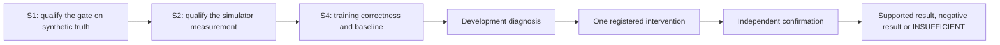

# PhysLoop

PhysLoop researches **closed-loop post-training of driving action policies** on NVIDIA's open stack. The primary study uses Alpamayo 1.5's continuous action expert in AlpaGym, with the visual/language backbone frozen.

The question is when a correctly implemented RL update improves held-out driving outcomes, and, when transfer fails, whether correcting one demonstrated mechanism changes it. The paired, stratified, road-adjusted gate is the measuring instrument. A rising reward curve is not the result.



## Focus and status

Plan v5 was adopted on 2026-11-01 under D-021 after three independent research lanes and cross-review. The active path is **S1 → S2 → S4 → research conclusion**. Student correction, Thor/HIL, optional shadow mode and broad scaling are deferred from this first study. The detailed [research review](docs/research/2026-11-01-rl-direction-review/report.md) covers 34 paper sources and pinned NVIDIA code, with explicit transfer limits and an engineering acceptance specification.

S1's synthetic qualification is complete. S2's free preparation and one bounded synthetic Vast host check are complete; the VM/storage were destroyed, with $0.60 recorded usage. Scientific S2 and all S4 runs remain unadmitted. No full AV pipeline or learning gain has been measured.

D-018 assigns evaluator engineering to agents and preserves Huy's scientific/model-research decisions. The nested $100 pilot / $1,200 S2 / $2,500 project caps remain. Actual rental, funding, project-asset licenses/access and scientific registration remain separate gates; see [the approval packet](docs/S2_RENTAL_APPROVAL.md).

The gate's operational inference is conservative and equal-road. INSUFFICIENT blocks GO; GO does not itself prove improvement. A checkpoint verdict does not automatically establish a training-method result. The prior broad simulation-engineering role map remains reference material, not a mandate to restore every deferred stage.

## Run the gate

```sh
uv sync --locked
uv run --frozen pytest -q
uv run --frozen python -m gate power
uv run --frozen python -m gate verdict comparison.json
uv run --frozen python -m gate qualify --output evidence/s1-local-reproduction
```

The verdict command accepts schema-version-1 raw arm records through `gate.api.parse_request`; `tests/test_api.py` contains complete examples. An invalid comparison exits with an input error. GO, NO-GO and INSUFFICIENT are valid results. Qualification must run from a source checkout; it refuses to overwrite an existing evidence directory. A different trial count or seed is a diagnostic run, not the registered qualification.

- [S1 implementation contract](docs/S1_IMPLEMENTATION.md)
- [Mathematical argument and assumptions](docs/S1_CORRECTNESS.md)
- [Recorded qualification report](evidence/s1-20261031-autonomous-v1/report.md)
- [Power tables](evidence/s1-20261031-autonomous-v1/power_tables.json)
- [S1 handoff and reproduction](docs/S1_HANDOFF.md)

The evidence is synthetic. Finite tests do not establish unconditional correctness. The proved error bounds assume independent complete road clusters, fixed sampling/strata and the registered look schedule. Reduced power is a measured tradeoff: noisy equivalent configurations can remain INSUFFICIENT even when a Gaussian planning calculation looks favorable.

## Start here

S2 handoff: [engineering specification](docs/S2_ENGINEERING_SPEC.md), [implementation and budget plan](docs/S2_IMPLEMENTATION_PLAN.md), and [research/agent operating model](docs/RESEARCH_OPERATING_MODEL.md). Check a draft with `uv run --frozen python -m gate.s2 preflight experiments/S2_PILOT_DRAFT.json`; its blocked result is intentional. Generate a fresh software verification record with `uv run --frozen python -B scripts/verify_s2.py --output evidence/s2-NEW-UNIQUE-ID`.

1. `DOC_AUTHORITY.md` — which document wins.
2. `docs/00_START_HERE.md` — reading order, the build rituals, and where we are.
3. `docs/02_PHYSLOOP_PLAN.md` — what we build, in what order, and what kills it.

When working with Claude Code, run `/reread` before every build session.
