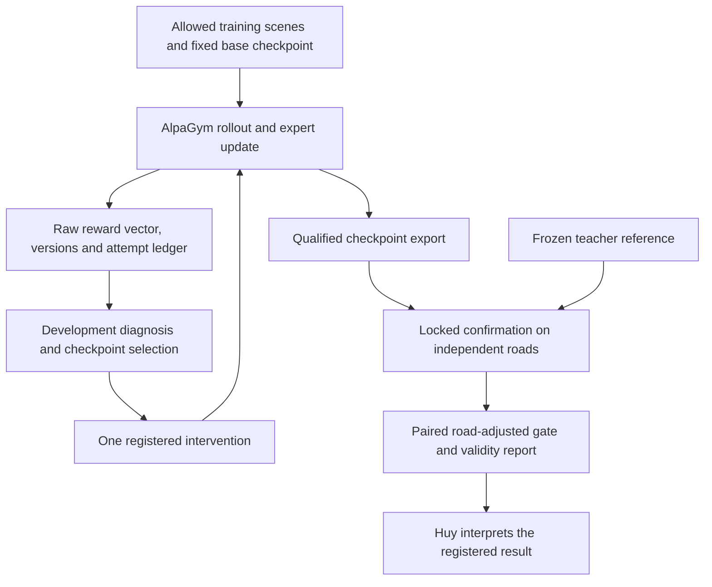

# 01 — System design (systems-thinking view)

This document is authoritative for the system map and the thirteen core concepts. It is v3.2 (2026-11-01):
- **v3.2** aligns the active map to plan v5/D-021 and corrects the operational gate and RL interpretation against the November 1 review. Deferred concepts remain background, not active implementation requirements.
- **v3 (2026-10-25)** added the teacher → student → Thor loop of plan v4 (D-012), corrected against `research/2026-10-25-teacher-to-thor/verification.md`.
- **v3.1** corrects C2, C4, C5, C6 and C10 against `research/2026-10-27-role-alignment/verification.md`, and adds C13 (D-015).

v1 and v2 are in `archive/`. Read this before any code.

## 0. The active research problem

Plan v5 (D-021) makes closed-loop action-policy post-training the primary research path. A policy can increase its training return without improving held-out driving: its reward may measure a different event, exploration may supply no useful alternatives, or simulation artifacts may supply shortcuts. These are candidate mechanisms to test, not failures already measured in PhysLoop.

The first question is when the shipped Alpamayo 1.5 expert update improves independent outcomes and, when transfer fails, whether one demonstrated correction changes it. Privileged-teacher imitation and on-policy correction are credible alternatives; direct RL is not assumed universally cheapest. See [the primary-source review](research/2026-11-01-rl-direction-review/report.md).

## 1. Goal and vision

**Goal:** a reproducible, bounded S4/G9 research conclusion supported by S1/S2's paired, stratified, road-aware gate. Start with the continuous action expert; visual/language weights remain frozen. Distinguish training correctness, measured learning, checkpoint improvement and a training-method conclusion.

The active path is S1 → S2 → S4. Student comparison/correction, runtime-reasoning curves, Thor/HIL and shadow mode are deferred extensions. The earlier teacher-to-Thor architecture remains historical in the v4.1 plan archive. Nothing here claims a production release, fleet deployment or real-world validation.

## 2. The active system map

The development loop can change the next hypothesis. Confirmation is not a source of adaptive failure mining while retaining the same confirmatory claim. Training-procedure confirmation also needs fresh training runs after selection or a reviewed selection-aware design; fresh roads alone are insufficient.

Three information boundaries matter. Reward is the optimizer's objective, not the held-out endpoint. Privileged scoring inputs must not enter deployable policy observations. Missing/retried/invalid episodes must remain in the attempt and validity accounting rather than disappear before the final report.

These boundaries motivate the measuring instrument without replacing the model-learning question. Agents own its engineering under D-018; Huy owns scientific definitions, model reward/loss/estimator research, predictions and conclusions.

## 3. Core concepts

Historical verification dates remain attached to facts. C6/C8/C9/C10 and the active/deferred interpretation were amended on 2026-11-01. Historical Gaussian power examples are not the operational gate; hardware/serving concepts do not admit deferred work.

**C1. The driving VLA has two brains.**
- **Architecture.** Alpamayo 1.5 (released checkpoint) pairs an ~8.2B VLM with a flow-matching action expert. The VLM is Cosmos-Reason2-8B on a Qwen3-VL architecture. The card lists the expert as 2.3B; the paper says 2B. The VLM writes a Chain-of-Causation trace, and the expert reads the VLM's KV cache to emit 64 waypoints over 6.4 s at 10 Hz.
- **Action space.** Unicycle controls `a ∈ [B, 64, 2]` (acceleration, curvature), with each step `a ← a + δt·v_θ(a, t, KV)`.
- **Step count.** Alpamayo 1.5 defaults to 10 Euler steps in code (`num_inference_steps = 10`), matching the paper's default δt = 0.1. The paper's own latency table uses 5 steps, and FlashDrive runs 8.
- **Inputs.** The released checkpoints take 4 cameras × 4 frames at 320×576. The token count, 180 per image and 2,880 in total, is derived (Qwen3-VL patch 16 × merge 2); NVIDIA states neither number. Egomotion history is 16 × (3 + 9) floats, tokenized as 48 tokens.
- **Reasoning length.** About 16 tokens per tick, as measured by FlashDrive.
- **Sources:** arXiv 2511.00088 v2; HF `nvidia/Alpamayo-1.5-10B` card and config.

**C2. Teacher and student.**
- **Positioning.** NVIDIA positions Alpamayo as a teacher distilled into compact runtime models on DRIVE AGX Thor.
- **State on 2026-10-25:**
  - **Distillation recipe:** alpamayo-recipes PR #42 (open, 10-20; no weights; ≥ 128 H100s recommended) distills Alpamayo 1 / 1.5 into a Cosmos-Reason2-2B student plus a compact expert. Its result is open-loop: minADE6 0.8875 m vs the teacher's 0.8298 m.
    - **Corrected 2026-10-27:** the 128-H100 figure is stage 1's alone; stages 2 (expert SFT) and 3 (DRaFT) each fit one 8 × H100 node.
    - Stage 1 already includes open-loop, token-level on-policy distillation.
    - The student's action head is trained on logged trajectories, not on teacher actions.
  - **Thor latency:** PR #45 runs such students at 171 ms in FP8 on DRIVE AGX Thor.
  - **Alpamayo 2 Edge** (2B, DRIVE AGX Thor, 10 Hz) was announced on 10-21. Its weights are promised "later this month".
- **Memory.** Alpamayo 1.5 needs 22.16 GB in BF16 (11.08B parameters) and about 11 GB in FP8. A 3B student needs about 6 GB in BF16.
- **Challenge limits.** 16 GiB per driver instance is a **hard limit**, so BF16 Alpamayo 1.5 does not fit and FP8 does. 0.1 s per call is a **target**, enforced through a throughput budget.
- **Thor.** "Thor" names two devices.
  - Jetson AGX Thor: 128 GB at 273 GB/s, JetPack 7.2.1 with TensorRT 10.16.2.
  - DRIVE AGX Thor: 64 GB at 273 GB/s, an ASIL-D design running DriveOS 7, with GPU memory set by carveout. TensorRT 11.x supports DRIVE AGX Thor only.

  The silicon matches, but the software stack does not, so numbers do not transfer 1:1. Every Thor claim names the device. The challenge's 16 GiB rule has nothing to do with Thor.
- **The production question:** what does the student lose, and where?

**C3. Open-loop vs closed-loop.** Open-loop evaluation compares predicted trajectories with logged ones. Closed-loop evaluation lets the model drive, so its errors compound.
- **nuPlan.** It called the two tasks "fundamentally misaligned" (arXiv 2306.07962). That is a qualitative trade-off; no coefficient is given.
- **Bosch 2026 (arXiv 2605.00066).** Open-loop L2 vs Bench2Drive driving score shows **no significant correlation** (n = 7). The paper prints ρ = −0.36, but recomputing from its own Table 1 gives −0.14. Its NAVSIM v1 ↔ Bench2Drive agreement does reproduce: ρ = 0.905 (n = 8).

**C4. Neural reconstruction.** NuRec rebuilds real scenes with 3D Gaussian Splatting and renders novel views when the ego deviates. AlpaSim wires renderer, traffic (log replay by default; CAT-K optional and unseeded), controller (MPC) and policy over gRPC. Its strength is that the long tail comes from real roads. Its weakness is C5.

**Corrected 2026-10-27:**
- **Traffic.** CAT-K exists only on `main`, where its sampling ignores the seed. The `e2e_challenge` branch, which carries the 441-scene protocol, has none: its traffic is log replay.
- **The renderer has a switch.** It can run NVIDIA's Cosmos-based Harmonizer. That is on in the `e2e_challenge` developer default and off in its competition preset, and NVIDIA plans to enable it for the final reruns (#222). The Harmonizer state is therefore part of the protocol.
- **The renderer is closed.** NRE is a proprietary, intentionally obfuscated container (#72).

**C5. Validity envelope.**
- **Fidelity loss.** Extrapolated views degrade. On EUVS (ICCV 2025), averaged over 9 methods, translation cuts PSNR by 24.6% and translation plus rotation by 30.6%. NuRec was not among the methods tested. OmniDreams shows NuRec degrading with deviation (Fig. 14).
- **Conflicting conventions.** The challenge scores a lateral exit of ≥ 4 m as **failure**. NVIDIA's papers instead **exclude** events beyond 4 m.
- **What we do.** Every rollout carries a validity record: maximum deviation from the log, in bins < 1, 1–2, 2–4 and ≥ 4 m. Out-of-envelope results are reported separately: never silently dropped, and never silently scored.
  - **(Corrected 2026-10-27)** Renderer agreement and replay-vs-CAT-K agreement are not per-rollout fields. They were deferred in plan v4, and CAT-K does not exist on `e2e_challenge`.
  - Their minimal versions are proposals P-013 and P-014.
  - Plan v4.1 adds the envelope as a dose–response curve, with NVIDIA's per-clip quality score as a covariate (`02` S2).

**C6. Paired regression statistics.** Both models run the same scenes, and only discordant pairs carry information.
- **Seeds (corrected 2026-10-27).**
  - On `e2e_challenge` the Alpamayo driver ignores the session seed: its sampling draws from the process-global RNG. So repeats are unseeded replicates, and pairing is by scene.
  - On `main`, per-tick reseeding works only with `force_determinism: true`.
  - Sharing seeds (common random numbers) helps only when the seed is consumed: σ_d² = σ_A² + σ_B² − 2ρσ_Aσ_B. S2 measures ρ; it is never assumed.
- **Worked example.** A fails 30 and B fails 24, with A-fail/B-pass = 12 and B-fail/A-pass = 6. Exact McNemar: P(X ≤ 6 | n = 18, ½) = 31,180 / 262,144 = 0.119, so two-sided p = 0.238. That is not evidence that B is better, and the test has power of only 0.22.
- **Repairs.**
  - Scenes cluster by road. D-016 operationally uses conservative bounded-road equal-road inference; cluster-adjusted McNemar/bootstrap remain references, not authorization methods.
  - Decide with **paired non-inferiority** against a pre-registered margin.
  - At 441 scenes and 4% discordance, the minimum detectable difference is about 2.7 pp.
  - The rule of three is a **one-sided** bound: 0/441 gives ≤ 0.68% one-sided and 0.83% two-sided.

**C7. Stratification and failure taxonomy.** Report per scenario type. A flat aggregate can hide a regression confined to a rare stratum: a 2.1 pp regression in a 2% stratum shows up as only 0.042 pp pooled.
- **Taxonomy.** Ground it in AlpaSim's native scorers (`collision_at_fault` = front or lateral, `collision_rear`, `offroad`, `wrong_lane`, `min_distance_to_obstacle_m`, `plan_deviation`, `safety_monitor_triggered`), mapped to the NHTSA pre-crash typology.
- **Coverage gaps.** Close-encounter, stall, oscillation and red-light have no challenge-branch scorer, so they are new work. The taxonomy is PhysLoop's own and not an external standard.
- **Minimum stratum size.** A 9-scene stratum has at most 0.2% power. Underpowered strata return INSUFFICIENT, which blocks GO.

**C8. Measuring the instrument (G3).**
- **Why not "correlate with an independent reference".** Drive-IRT re-fits the same rollouts the gate scores (reference R0, aggregation robustness), and on-road outcomes are unavailable.
- **Construct validity instead.** The full protocol runs: reliability → renderer and traffic agreement → known-group dose–response ladders → cross-paradigm convergence on 28–34 checkpoints → a discriminant check → a three-way verdict (archived `02` v3 §2).
- **What plan v5 keeps:** reliability and validity records for S2/S4. The student/device ladders and broader agreement/convergence studies are deferred.
- **Worked example** (5 policies). Gate [1,2,3,4,5] vs reference [2,1,3,5,4]: Σd² = 4, so ρ = 1 − 24/120 = 0.8. Under H0 at n = 5, P(ρ ≥ 0.8) = 8/120. Even at n = 10, an observed 0.8 has a 95% CI of about [0.24, 0.96]. That is why we need n ≈ 28–34.
- **Prior art.** Pseudo-simulation reports r = 0.89 (Pearson, 83 privileged planners, sim-to-sim against nuPlan). Nothing comparable exists for AlpaSim.

**C9. Guardrail in the loop.** DRIVE AV runs the end-to-end stack in parallel with a classical safety stack built on Halos, in both the L2 Mercedes CLA and the L4-ready S-Class. Scoring the bare model therefore scores something that never ships.
- **Deferred design: the gate would score model + guardrail.** The guardrail is a TTC / drivable-area monitor behind AlpaSim's `safety_monitor_safe` hook. It is **PhysLoop's own design**: no public source specifies Halos's runtime-monitor logic.
- **Intervention rate.** The gate reports it as an early regression signal.
- **Status in plan v4:** G4 is deferred, not dropped. NVIDIA's Alpamayo Stack pairs the reasoning model with policy evaluators, safety monitors and Halos (verified 2026-10-25), so the argument above still holds.

**C10. Precision and throughput.**
- **The expert is memory-bound.** For π0, VLA-Perf models the action expert at an operational intensity of 54 FLOP/byte, against ridges of about 279 (RTX PRO 6000 Workstation, BF16) and about 947 (Jetson AGX Thor). That is a roofline model, not a measurement, and it describes π0, not Alpamayo.
- **What FlashDrive measured** on Alpamayo 1.5: 717 → 151 ms, mostly from streaming KV reuse, speculative reasoning, adaptive steps and CUDA graphs. The "adaptive steps" are a fixed velocity-reuse schedule, in which 4 of 8 steps reuse the previous velocity. Its streaming KV reuse needs expert-only fine-tuning (corrected 2026-10-27). W4A8 removed only 24.6 ms. The expert still runs at about 20% of its bandwidth bound (113.9 ms measured vs ≈ 22.3 ms, 8 steps).
- **Quantization recipe.** NVIDIA's ModelOpt recipe already quantizes the expert, but publishes open-loop minADE only. The open gap is closed-loop per-format verdicts.
- **AlpaGym, re-verified 2026-11-01.** It trains the continuous expert with visual/language weights frozen and skips autoregressive reasoning generation. A group-constant judge score supplies no relative action signal; a candidate/state-dependent judge could affect expert learning, but would not become language-model training. Adapted judge inputs need separate validation.
  - Its Gaussian log densities are averaged across denoising/action coordinates before the ratio; this geometric-mean surrogate differs from the joint ratio within a replay row. Log difference is clamped before exponentiation, followed by PPO clipping; clipping is not a hard KL guarantee.
  - The base one-candidate/KL-off zero-gradient case skips the optimizer. The advertised two-GPU smoke uses two candidates, not one.
  - Online raw metric aggregation differs from offline masks/truncation/derived contact metrics. Normal episode artifacts omit dense metrics; capture is required for the event audit.
  - A zero-staleness setting does not alone reject stale samples; verify actual versions. Preserve attempts before retry/drop cleanup.
  - Exact SHAs, release snapshot and source locators are in [the stack audit](research/2026-11-01-rl-direction-review/nvidia-stack.md). Source inspection does not qualify runtime fit or learning.
- **An unused speed-up.** NVIDIA's opt-in expert CUDA graph (alpamayo1.5 PR #36) is merged but never enabled in AlpaSim's driver (C13).

**C11. The Thor latency budget is set by memory bandwidth.** Decoding one token reads every backbone weight once: t_tok ≈ bytes / 273 GB/s.
- **Teacher.** A 10B FP8 backbone costs about 30 ms per token. Prefill of 2,560 vision tokens alone takes ≈ 99 ms even at 100% of peak. So no 10B configuration reaches 10 Hz.
  - Measured on Jetson AGX Thor: official BF16 build 3,322 ms; FlashRT 811–897 ms (PR #229).
- **Student.** A 2B NVFP4 student costs ≈ 4.1 ms per token. At the bound, about 10 CoC tokens fit in 100 ms. At measured efficiencies (decode ≈ 78%, expert ≈ 20% of bound) only about 3 fit. Streaming reuse of history-frame prefill raises that to ≈ 10–20.
  - Measured: NVIDIA's 2B students run at 171 ms (FP8) on DRIVE AGX Thor.
- **Deferred question:** runtime reasoning is a budget; the score-versus-token curve belongs to a future S5/S6 extension, not the current RL headline.
- **Sources:** `research/2026-10-25-teacher-to-thor/review.md` §3.1; FlashRT PR #229; recipes PR #45.

**C12. Shadow mode is open-loop.** In shadow mode the student predicts, but the human drives. The student never experiences the consequences of its own errors, so covariate shift, the reason closed-loop evaluation exists (C3), is invisible. Disagreement with the driver belongs to the same metric class as open-loop L2.
- **What shadow mode is good for:** mining out-of-distribution data (PAI-AV has no Asian country), measuring real-sensor latency on the device, and building a real-world open-loop benchmark.
- **What it cannot do:** validate driving quality.
- **Confound:** the rig's own sensor shift mixes with scene shift, so a within-rig contrast is needed (`02` S8).

**C13. The closed loop is a throughput system** (added 2026-10-27; inferences labelled).
- **Where the time goes.** Each AlpaSim rollout step runs the renderer, the driver (the policy), the controller and physics over gRPC.
  - The stock Alpamayo 1.5 driver runs eager PyTorch at batch 1 (`max_batch_size: 1`); no Alpamayo adapter batches across rollouts.
  - NVIDIA's own 8-GPU Alpamayo 1.5 evaluation topology (`main`) puts two driver replicas on each of GPUs 0–6, and the renderer and physics share GPU 7.
  - So the policy is probably most of the cost: 73–87.5% of step GPU-time, by inference. S2 measures it.
- **Every lever has a ceiling.** A lever that speeds up a share f of the step by k gives at most S = 1/((1 − f) + f/k) (Amdahl).
  - **The expert CUDA graph.** NVIDIA's opt-in expert CUDA graph (alpamayo1.5 PR #36) was reported bitwise-identical in a PR comment. It cut policy-call latency by 15.5% (10B) and 31.5% (2B), in one paired AlpaGym sample each. That is about 11–14% of an Alpamayo 1.5 sweep, by inference.
  - **Batching across rollouts** can do more, but it changes the random streams, so it needs an equivalence verdict (P-015).
- **RL adds a second balance.** AlpaGym runs rollout generation and training on separate GPUs, so throughput follows N_gen·g ≈ N_train·t.
  - NVIDIA's 8-GPU preset splits the node into 1 policy, 3 rollout and 4 AlpaSim GPUs.
  - In the PR #36 thread, a 10B AlpaGym iteration spent about 75% of its time outside trainer compute when eager, and 58% with graphs. These shares are derived from the PR's own numbers.
  - So the simulator and the policy's inference, not the optimizer, bound closed-loop RL.
- **Measure it the way NVIDIA does:**
  - AlpaSim's full-run seconds per rollout, after 30–45 minutes of stabilization;
  - GPU-hours from the mean wall clock, never the median (recipes PR #44);
  - MFU, HFU and OFU.
- **Why it matters here.** Every cost in `02` is a sweep count × a step time, so a measured profile re-prices the plan. A speed-up proven bitwise-identical is a performance claim the gate can make without changing what it measures.

## 4. Teach-back (answer before re-reading)

1. Why is "A fails 30, B fails 24 on 441" not enough to release B? Recompute the p-value and the power.
2. An FP8 student scores higher than the teacher, but 18% of its rollouts exceed the deviation cap. What do you conclude, and how do you report it under both the 2 m and the 4 m conventions?
3. Prediction, written before the deferred cross-paradigm study (v3's S5): what ρ do you expect between the gate and Drive-IRT on 10 policies? (Preserved from v1; now reference R0, an aggregation-robustness check, not a validity check.)
4. How can a guardrail hide a model regression, and which metric exposes it?
5. Why can a ρ < 0.6 kill rule not be decided at n = 10, and what n can decide it?
6. "RL cut at-fault collisions by 20%" on 441 held-out scenes, with a base rate of 8% and 4% discordance. Is that claim decidable? How many paired scenes would it need?
7. A 2B student runs at 171 ms with reasoning on DRIVE AGX Thor, yet a 2B model is announced at 10 Hz on the same device. Name three levers that close the gap. Which of them change what the model does in closed loop?
8. AlpaGym clips a mean log-ratio over 640 elements at [0.8, 1.2]. What band is that on the joint ratio, and what does it leave of the clip's protection?
9. S2's three repeats per scene come from a driver that ignores its seed. What do test–retest and the negative control measure then, and what must change before seeds can pair two checkpoints?
10. The driver takes a share f of each step's GPU-time. What is the most any driver-only speed-up can give the sweep, and how would you prove that it did not change the verdict?
