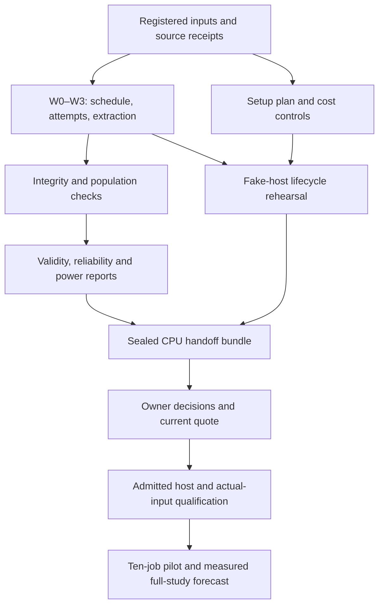

# S2 CPU preparation to GPU pilot: engineering specification

Agent-authored · 2026-11-07 · implementation backlog, not a scientific registration.

**Scope correction, 2026-11-07:** Huy challenged the need for all fourteen packages and then authorized the reduced execution path. This document is a backlog, not a prerequisite checklist for the first rental. The immediate work is ingestion handoff, a small setup inventory, existing host-probe/cutoff repairs, cost/export checks and one synthetic rehearsal. Follow [the minimal pilot runbook](S2_MINIMAL_PILOT_RUNBOOK.md). Reliability/power and population analyses remain required at their full-study/S4 decision points; reusable infrastructure is built only when needed. The acceptance list in §11 describes the full backlog, not the reduced preparation milestone.

## 1. Goal and authority

Finish the software that can be qualified with CPU fixtures so the next approved GPU allocation executes a prepared, bounded qualification and pilot, rather than becoming an open-ended installation/debugging session.

This document implements **S2.1–S2.7 [C], G1/G2/G3·R1/G7**, under D-017/D-018 and plan v5/D-022. It extends the task breakdown of [the November 7 specification](research/2026-11-05-contribution-review/implementation-spec-2026-11-07.md), especially W4/W5 and the operational handoff. It does not replace [the plan](02_PHYSLOOP_PLAN.md), [decision log](DECISIONS.md), existing schema-v2 scientific drafts, or [rental approval packet](S2_RENTAL_APPROVAL.md).

**Deliverable of this review:** this specification, code inspection, targeted existing CPU checks and independent read-only reviews. The proposed modules, commands and tests below are not implemented by this document.

**Concurrent ownership:** another agent owns W0–W3: active two-arm planning, identities, schedule, attempt ledger, raw extraction and integration with the existing adapter. Treat that work as an incoming dependency, not finished software. Do not edit those files concurrently or recreate their data structures elsewhere. The rest of this specification is the next implementation queue.

**Completion boundaries:**

| State | Meaning | Does not mean |
|---|---|---|
| `CPU_REHEARSED` | Synthetic/reference inputs, negative controls, fake host execution and sealed-bundle replay pass | Real simulator compatibility, scientific admission or rental authority |
| `PACKET_COMPLETE` | Technical facts and owner decisions required for the specific next action are recorded and reviewed | The approved action has been executed successfully |
| `HOST_QUALIFIED` | Named delivered host passes its bounded acceptance checks | Full teacher/renderer/Harmonizer fit or data validity |
| `ACTUAL_INPUT_QUALIFIED` | Actual artifacts agree with raw capture, parser, schedule and scorer tests | Reliability, adequate power or a learning result |
| `S2_ACCEPTED` | Registered controls, reliability, validity, power and measured forecast meet the mandatory S2 acceptance criteria | S4 is automatically admitted |
| `S2_STOPPED_OR_INSUFFICIENT` | A limitation or failed criterion closes the measured study with an explicit result | Acceptance or eligibility to proceed to confirmatory RL |

These are proposed report labels, not additions to the frozen protocol schema. Keep planning readiness, evidence integrity, human authorization and runtime qualification in separate fields.

## 2. Verified starting point

Review base: `3741d9233a0c01a27d3f02306311bb008a8ae3b6`. The working tree has concurrent, uncommitted changes. A git SHA alone cannot identify it; final qualification must archive the exact tested source.

| Boundary | Existing code/evidence | Remaining work |
|---|---|---|
| Structural pairing and decision | `gate/contracts.py`, `gate/api.py`, `gate/verdict.py`, `gate/sequential.py` | Reuse; qualify real sampling assumptions separately |
| Offline preregistration checks | `gate/s2_preflight.py::validate_s2_preflight` | Inspect referenced bytes, bind scope and reconcile the incoming schedule without pretending hashes authenticate approvals |
| Summary normalization | `gate/alpasim_adapter.py::normalize_summary` | W0–W3 supply evidence-derived sidecars; maintain whole-batch rejection |
| Upstream known answers | `tests/test_alpasim_ground_truth_upstream.py` | Existing tests execute two exact geometry helpers, not the whole evaluator; extend source-path coverage |
| Power | `gate/power.py`, `gate/synthetic.py`, `gate/experiment.py` | Fixed S1 planning/scenario machinery exists; no S2 design-specific sensitivity runner or real-data estimator |
| Reliability/validity/contamination | Contracts and source reviews | No dedicated S2 analysis implementation found in `gate/` during review |
| Host probing | `scripts/vast_s2_host_probe.sh`, monitor/exporter/XID helpers | Synthetic host checks exist; no complete S2 runtime setup bundle |
| Lifecycle | `scripts/vast_stop_watchdog.py` | Exact-ID/label stop exists; reusable budget/export/destroy/reconciliation workflow remains |
| Evidence | `scripts/verify_s2.py` | Archives sources and hashes, checks drafts; it executes tests in the live checkout, so a quiescent snapshot is required for concurrent-work qualification |
| Dependencies | `pyproject.toml`, `uv.lock` | CPU evaluator environment; not proof of a Linux/CUDA AlpaSim runtime environment |

The selected stable suite passed **259 tests in 10.02 s** during this review (§12). The earlier 756-test report belongs to the supplied prior review; it is not reasserted as the current complete-suite result. Incoming ingestion tests are under active development.

Read the protected manifest before each implementation change. `gate/verdict.py`, `gate/stats/`, the manifest, hooks and settings remain untouched. Import protected inference; do not copy or replace it to evade protection.

## 3. System boundaries and dependency order



Two preparation tracks can progress independently: measurement software and operational setup. They converge in one CPU rehearsal. A cost-only pilot does not need completed full-study reliability estimates; those require real repetitions. Do not delay the pilot for optional profiling, dashboards or future-stage work.

### Incoming W0–W3 handoff

Ask the owning agent for a versioned artifact/API contract, not a second implementation. Required exports are:

1. Canonical protocol/arm/schedule identities and a file manifest with source revisions.
2. Explicit jobs: pilot **5 scenes × 2 Harmonizer states × 1 replicate = 10**; full **2 arms × 441 scenes × 3 replicates = 2,646**, before retries and diagnostics.
3. Every attempt and unresolved job, including crashes before upstream UUID allocation; parent/retry reason preserved.
4. Full raw-stream references and verified observations, with coverage, completion and deviation evidence.
5. Adapter admission result and all rejection reasons; failed observations remain available to descriptive reporting even when no records are admitted.
6. Retry-selection status. Preservation of retries does not itself authorize selecting a successful retry for inference. Until a registered rule and separately tested selection path exist, keep the current adapter's blocking behavior.
7. Independently checked fixtures for missing offroad, late 4.2 m deviation, conflicting events, changed checksums and short horizons.

Integration rule: downstream modules consume these outputs. They must not rescan raw files with a competing parser, silently choose retries, or reconstruct missing source identities.

## 4. Shared engineering contracts

All new JSON artifacts carry an artifact schema/version, source/config hashes, producer revision, input artifact hashes, scope (`synthetic`, `public_source_fixture`, or `actual`), units and explicit issues. A new artifact version is not protocol schema-v3. Runtime timestamps and nondeterministic metadata are excluded from deterministic-content comparisons in a documented way.

Use distinct statuses: `passed`, `blocked`, `not_run`, `not_estimable`, `unverified`, `not_applicable`. Absence is not a passing observation. A valid diagnostic report can exist for a rejected batch; it must not contain an admitted verdict.

Issues use stable `{code, path, severity, evidence_refs, message}` fields. Unknown versions and required fields fail closed. All filesystem consumers confine relative references to the declared root; reject traversal, absolute external paths, symlink escapes and duplicate normalized names. Verify bytes at consumption, not just at discovery.

No credentials in artifacts, command logs or profiler environments. Keep controller/provider credentials off the guest. Use existing environment allowlisting in host probes; synthetic secret canaries test leakage without accessing real secrets. Old evidence remains immutable and restricted; a previous credential-revocation item in P-032 needs an owner status, not a secret search or automatic account mutation.

Define each public function as pure where possible. Inject filesystem readers, process runners, clocks and provider inventory clients into effectful boundaries. CPU tests use fake implementations. No default command provisions, funds, accepts terms, downloads gated assets or launches workloads.

## 5. Implementation tickets

Paths and callable names below are proposed homes. Consolidate small helpers when sensible; do not build a general workflow framework. Tests precede implementation. Independent reviewers derive literal oracles and adversarial cases rather than merely copying the implementation's equations.

### CPU-00 — Freeze the incoming interface and qualification snapshot

**Placement:** S2.1/S2.3, G1/G2/G7. **Depends:** W0–W3 handoff. **Priority:** before integrated qualification.

**Work:** document exported types/CLI schemas and integrate a tiny fixture contract test in `tests/test_s2_handoff.py`. Record a source manifest including dirty/untracked implementation files needed for replay. Run qualification in a separate snapshot of those exact bytes; never claim tests run on a changing checkout qualify its later state. Coordinate ownership of `gate/s2.py`, `pyproject.toml`, `uv.lock`, shared tests and `scripts/verify_s2.py`.

**First failures:** missing producer version, incompatible schedule version, changed source after snapshot, and an artifact built from a different protocol hash. All block integrated qualification.

**Done:** one input contract, source hash and review receipt; no duplicate schedule/ledger code. Other tickets can use contract fixtures while W0–W3 completes, but integration cannot pass against stubs.

### CPU-01 — Source/runtime/asset inventory

**Placement:** S2.1/S2.2/S2.7, G2/G7. **Depends:** none for fixture work. **Priority:** before rental packet completion.

**Homes:** `gate/s2_runtime.py` (inventory and plan helpers), `tests/test_s2_runtime.py`; source/asset inventory in the generated handoff bundle.

**Interface:** `validate_runtime_inventory(inventory, receipts) -> issues`. Record separate entries for AlpaSim runtime and evaluator, Alpamayo driver/model, processor/tokenizer/config, renderer image, Harmonizer, CPU lock, upstream runtime lock(s), OS/architecture and launcher source. Each entry has immutable revision/digest, evidence reference, resolution status, permitted acquisition step and expected byte count or explicit unknown. Model dependency discovery must include indirect processor/base-model fetches.

**Work:** resolve inspectable public-source facts; reuse pinned audits and refresh upstream at admission. Keep Linux/CUDA runtime constraints separate from the Mac/CPU lock. Resolve image platform manifests, not merely a mutable tag. Produce a download plan scoped to five pilot scenes and needed shared assets; never treat the curated 441-scene preset as a five-scene allowlist. Include images, weights, cache, extraction scratch, raw logs and simultaneous temporary copies in disk demand.

**First failures:** mutable tag without digest; wrong platform; omitted indirect asset; file-byte hash not matching receipt; pilot plan expands to 441 scenes; unknown byte count reported as zero; stopped instance with retained disk omitted from inventory.

**Done:** all inspectable facts resolved; inaccessible image manifests, bytes or terms explicitly unresolved. Draft manifests keep unknowns; no fabricated hashes. CPU resolution does not prove wheel/driver compatibility or simultaneous VRAM fit.

### CPU-02 — Evidence-aware readiness report

**Placement:** S2.1/S2.2, G2/G7. **Depends:** CPU-00/01. **Priority:** before rental packet completion.

**Homes:** `gate/s2_readiness.py`, `tests/test_s2_readiness.py`. Reuse `validate_s2_preflight` rather than weakening it.

**Interface:** `inspect_readiness(plan, evidence_index, schedule, action_record=None) -> report` returns separate `planning_consistency`, `evidence_integrity`, `owner_decisions`, `action_scope`, `host_qualification`, `scientific_admission`, and `next_blocking_checks`.

**Work:** verify local references and hashes; check dates, phase, exact source/config bindings and evidence scope. A host-smoke receipt cannot satisfy model/renderer qualification. A synthetic approval fixture cannot satisfy a real action. D-019 is closed. A typed field saying Huy approved is still a declaration unless linked to an inspected actual owner record; hashes prove unchanged bytes, not authorship. Keep the existing validator's `cloud_launch_authorized=false` semantics.

Separate pre-rental requirements from post-provision host checks, so the report explains that compatibility can only be measured after a separately approved bounded setup. Do not relax scientific launch checks to resolve this sequencing.

**First failures:** nonexistent reference; changed bytes; receipt for another host/phase; expired quote; frozen manifest changed after review; closed D-019 supplied as new authority; all planning fields populated but no actual approval. Report precise blockers; do not prompt repeatedly for authority already recorded for an uncompleted scope.

**Done:** blocked real drafts remain blocked, fake approved fixtures are clearly synthetic, and the report names the next actionable missing fact without implying authorization.

### CPU-03 — Population and contamination audit

**Placement:** S2.1/S2.5/S2.6, G1/G2/G3·R1. **Depends:** CPU-00 and W1 identity receipt. **Priority:** before full-study freeze; pilot allowlist checks before pilot.

**Homes:** `gate/s2_population.py`, `tests/test_s2_population.py`.

**Interface:** `audit_population(catalog, assignments, role_membership, overlap_rule) -> report`. Inputs include source capture/clip ID, time interval with units/boundary convention, scene asset identity, road ID and its evidence, stratum and role. Preserve the original split label; do not interpret the mere presence of `alpamayo_aligned` as contamination.

**Work:** report counts by road/scene/stratum; missing IDs; conflicting road assignments; duplicate content under different labels; capture/time overlap; pilot/instrument/development/confirmation intersections. Unknown overlap is `unverified`, not clean. Apply only a recorded overlap/exclusion rule; no automatic road clustering, scene replacement or stratum merging. Inspectable metadata can be audited now; absent licensed metadata cannot.

**First failures/known answers:** three scenes on two roads remain two roads after replicate count changes. Same source intervals `[0,10)` and `[8,12)` overlap for exactly 2 units; `[0,10)` and `[10,12)` do not under that fixture's half-open convention. Missing capture lineage is unknown. One road assigned two strata rejects. A changed asset under the same ID rejects. Reordering input preserves the report's canonical content.

**Done:** explicit overlap tables and unresolved counts with source references; no unsupported claim of statistical road independence or unseen training-data cleanliness.

### CPU-04 — Validity and complete-denominator report

**Placement:** S2.3/S2.5, G2. **Depends:** W2/W3, CPU-03. **Priority:** before actual-input qualification.

**Homes:** `gate/s2_diagnostics.py`, `tests/test_s2_diagnostics.py`.

**Interface:** `describe_validity(schedule, attempts, observations, validity_definition=None) -> report`. Consume W3 observations; do not implement a second extractor.

**Work:** count planned jobs, launched attempts, retries, completed/failed/cancelled/unresolved attempts and selected observations separately. Report full deviation bins `<1`, `1–2`, `2–4`, `>=4 m`, plus unknown; lateral corridor, overshoot, terminal, map, render coverage, black frames and nonfinite poses independently. Report A-valid/B-valid 2×2 counts only under a supplied validity definition; keep unknown/missing assessments outside the binary table and show their denominator. Retain diagnostics on a rejected batch; do not feed its surviving rows to the gate.

**First failures/known answers:** `[0.5,1,2,4,None]` gives one observation in each of four bins and one unknown. A fixture with both-valid/A-only/B-only/neither plus one unknown totals five comparison pairs (ten arm-specific logical jobs); the binary table contains four pairs and the unknown category contains one. One failed attempt then one successful retry is one job, two attempts, one retry. A late 4.2 m deviation remains out-of-envelope even when the summary truncates earlier. A black frame and a NaN pose can both be counted.

**Done:** all counts reconcile to W2; every excluded/blocked unit has a reason; missingness sensitivity is a separately labelled artifact and never fabricated observed records.

### CPU-05 — Repeatability diagnostics and probe comparison

**Placement:** S2.4, G3·R1/G7. **Depends:** W3, CPU-03/04. **Priority:** tooling before full controls; real acceptance after measurement.

**Homes:** `gate/s2_diagnostics.py`, `gate/s2_probes.py`, corresponding tests.

**Interfaces:** `describe_repeats(records, grouping) -> diagnostics`; `compare_probe_artifacts(reference, repeat, probe_spec) -> report`. Keep policy/checkpoint, road, scene, simulator replicate and later training-run axes explicit. Outputs include counts, within-scene variation, paired event contingency/discordance, exact input hashes and first differing tensor/frame/tick. Report sample variance versus population variance by name.

**Work now:** CPU synthetic utilities and fake fixed-input policy/fixed-pose renderer receipts; compare numeric arrays with declared dtype, shape, units and comparator. Distinguish identical checkpoint tensor values from different serialization-file hashes. CPU byte comparison only qualifies the comparator. Fixed-input GPU behavior, renderer noise and consumed seeds remain unverified.

**Scientific boundary:** require a frozen method ID, estimand, hierarchy, interval method, floor, missing-data and degenerate-case convention before an inferential reliability PASS/KILL. If absent, return descriptive diagnostics plus `method_unregistered`; if the supplied method is not implemented/qualified, return `unsupported_method`, never PASS. Do not choose an ICC variant or uncertainty method silently; specifying and independently reviewing the chosen estimator is a dependent ticket after Huy's contract. No policy-panel Kendall W for a two-arm same-policy control.

**First failures/known answers:** repeats `[0,1,0]` have sample variance `1/3`; `[1,1,1]` have 0. No between-scene variation makes some reliability coefficients undefined, not perfect. Zero total discordance makes a discordance ratio `not_estimable`. Same seed with different inputs is not a determinism test. Same bytes but mismatched shape/dtype must not pass tensor parity. Out-of-order events preserve the first semantic divergence, not file traversal order.

**Done:** exact descriptive/reference checks, contract-driven method dispatch, and clear `not_run` for real probes. No renderer-agreement expansion or RNG port is introduced.

### CPU-06 — Operational power and design sensitivity

**Placement:** S2.6, G1/G3·R1. **Depends:** CPU-03/05; can start on synthetic inputs. **Priority:** before full-study commitment and S4 handoff.

**Homes:** `gate/s2_power.py`, `tests/test_s2_power.py`. Import `gate.api.evaluate`, `gate.sequential.SequentialGate`, `gate.synthetic.generate` and the protected bound; never replace them with a convenient normal approximation.

**Interface:** `run_sensitivity(design, scenarios, rng_seed, trial_count) -> report`. A scenario names metric kind/direction/bounds, generation-law ID, effect, road/scene/replicate composition, dependence construction, strata, margins, look schedule and information role. Binary scenarios additionally specify a feasible joint event law, including event rate and paired discordance. Bounded continuous scenarios need an explicit supported joint generator; reject unsupported laws rather than binarizing scores. Include a simple bounded continuous known-answer fixture through the actual continuous gate path. Preserve actual unequal scene/road layouts when simulating the registered design. Existing synthetic `*_correlation` parameters are copy probabilities, not calibrated ICC values; label them accordingly. Add only an unlocked generator extension when an irregular layout is required, with marginal/cluster known answers.

**Outputs:** GO/NO-GO/INSUFFICIENT frequencies, trial count, Monte Carlo uncertainty using a named method, expected stopped work where relevant, and hashes of scenario/source inputs. Report each scenario as an assumption, not measured RL variance. Show zero-difference control support as a diagnostic alongside the operational simulations; it is not a universal minimum-road rule.

**First failures/known answers:** at alpha .05, identical zero differences require 36/51/72/183 roads for strict GO at margins .10/.07/.05/.02; verify the previous integer fails. Five road differences of −1 yield upper `0.04364750021196295`, so an unconditional 72-road blocker would be wrong. Missing required strata cannot GO. Duplicate replicates do not add independent roads. Sequential runs use actual per-look alpha and complete-road batches; no extra unregistered look. Enumerate a tiny binary sample space independently as a deterministic oracle for verdict probabilities; add fixed-seed Monte Carlo regression with a predeclared tolerance and false-failure budget. Report Monte Carlo intervals separately: a finite interval has no guarantee of covering the exact probability on every run.

**Done:** replayable scenario outputs through the actual gate, no tuning of margins/strata from pilot outcomes. A planner can reveal poor power; it cannot authorize an inference-method change. Real same-policy measurements update permitted nuisance inputs only; keep an effect/discordance sensitivity range.

### CPU-07 — Telemetry and useful-work accounting

**Placement:** S2.7, G7. **Depends:** W2, runtime inventory. **Priority:** before GPU qualification/pilot.

**Homes:** `gate/s2_telemetry.py`, `tests/test_s2_telemetry.py`. Reuse upstream Prometheus/DCGM/Nsight outputs and current monitor scripts; do not build a dashboard service.

**Interface:** `summarize_telemetry(samples, allocation_intervals, attempts, clock_metadata, stabilization_rule=None) -> report`.

**Work:** parse pinned metric names/units, preserve raw references and counter reset events; report observed coverage/gaps and whether unsupported, absent, failed or healthy. Keep UTC correlation timestamps and monotonic durations distinct, with process/clock scope. Account startup, acquisition, warm-up, active, retry, idle and tail using a declared nonoverlapping allocation-time partition. Service intervals may overlap and must not be summed into billed wall time. Report useful completed episodes per paid wall-hour and per GPU-hour; label stabilized throughput separately and require its registered rule. Include peak memory from sampled data with its sampling limitation.

**First failures/known answers:** two GPUs allocated for 1,800 s = 1 GPU-hour. Four admitted useful episodes over that allocation = 8 episodes per wall-hour and 4 per GPU-hour. Constant 100 W for 10 s = 1,000 J under a defined integration fixture. A gap beyond the configured coverage limit yields incomplete energy, not interpolated certainty. Counter reset is not negative traffic. DCGM `NO_DATA` is not zero XIDs. Missing synchronized device timing cannot become a kernel latency claim.

**Done:** raw-to-summary CPU fixtures, clear unavailable fields, and a probe plan for actual monitor delivery. Do not claim all GPU faults can be observed merely because NVML subscription or DCGM scraping works.

### CPU-08 — Budget ledger and next-unit stop decision

**Placement:** S2.2/S2.7, G7. **Depends:** W0 active cost planning, CPU-07. **Priority:** before rental packet completion.

**Homes:** `gate/s2_cost.py`, `tests/test_s2_cost.py`. Reuse the active planning report from W0; this ticket supplies observed accounting and conservative continuation checks.

**Interfaces:** `reconcile_cost(events, quote, scope) -> ledger`; `can_start_next_unit(ledger, limits, unit_upper_bound, teardown_reserve, clock) -> decision`. Use exact decimal currency or integer minor units, explicit currency/rate basis and provider billing granularity. Never assume per-node and per-GPU rates are interchangeable.

**Work:** track cash deposits, usage accrued, available credit, unsettled liabilities, storage retention, transfer, tax/fees and reserves separately. Do not count prepaid consumption as a second cash payment. Enforce both approved cash limits and resource-usage limits, nested pilot/S2/project caps, and the earlier of deadline or resource/cost exhaustion. Reconcile prior S2 expenditure from actual records; do not reset totals to zero or add nested ceilings. Preserve registered independent-evaluation/confirmation reserves as well as cleanup headroom; their amounts are inputs, not invented approvals. Unknown charge exposure blocks continuation unless a documented conservative bound covers it.

**First failures/known answers:** 2 GPUs × 0.5 h × $2/GPU-h = $2 compute. A $10 deposit followed by $3 usage means cash paid $10, usage $3, credit $7, not $13 cash. With $10 usage allowance, $6 accrued, $1 unsettled liability and $1 teardown reserve, a next-unit upper bound of $2 is rejected at the equality boundary under the proposed strict-headroom rule. Already at a deadline blocks. Rounding a 61-second job to two billed minutes must be charged. Provider errors cannot clear outstanding liability.

**Done:** no next unit begins without headroom for its upper bound and cleanup; diagnostic decisions never become rental authority. The strict boundary is an engineering conservative stop rule, not a new budget approval. No retrospective provider settlement guarantee is possible.

### CPU-09 — Reproducible setup plan and staged bootstrap

**Placement:** S2.1/S2.2/S2.7, G2/G7. **Depends:** CPU-01/02/08. **Priority:** before rental packet completion.

**Homes:** `gate/s2_runtime.py`, `scripts/s2_prepare_bundle.py`, `tests/test_s2_runtime.py`. Add guest bootstrap glue only against verified upstream commands, not guessed service flags.

**Interface:** `build_execution_plan(runtime_inventory, phase, receipts) -> ordered_steps`. Each step declares ID, exact argv array, env allowlist, input hashes, required authority/capability, expected outputs, timeout, rerun policy and failure cleanup. No shell-evaluated string interpolation. Planned actions and effective resolved configs are both retained.

**Stages:** inspect guest → qualify public synthetic host → verify permitted asset access/acquire approved subset → verify bytes/cache → render resolved upstream Compose configuration → start required services → actual-input checks → run the registered ten-job pilot → export → stop/destroy/reconcile. Image/build/license/acquisition gates are explicit. Reuse upstream run methods; no Kubernetes, custom trainer, service mesh or replacement scheduler.

**Required host-script repair before reuse:** `scripts/vast_monitor_control.sh:12` and `scripts/vast_exporter_control.sh:15` embed a local CUDA image ID from the old VM. Accept a validated run-specific pullable image digest, resolve its actual local ID on the target host, and pass that identity to the probes. `vast_exporter_control.sh:32` stops `nvidia-dcgm` unconditionally; its original disposable-host assumption must become an explicit service-ownership check. Record prior service state, reject a foreign host-engine conflict, and restore state only within recorded authority. These are unlocked engineering-script changes with fake-command tests, not changes to old evidence.

**CPU execution:** generate/replay against fake process and inventory clients. Check Compose/schema semantics with public fixture configurations or available local tooling without pulling images. A missing local Docker command is `not_run`; pure-YAML checks are not reported as successful Compose execution. Validate model-loading config without importing/loading weights.

**First failures:** missing image digest, old-host local image ID on a fresh host, changed resolved config, unapproved asset URL, attempted stop of a foreign DCGM service, warm-up consuming allowance, environment secret canary, wrong GPU edition, wrong architecture and successful installer exit with failed capability probe. A permitted filename containing whitespace/metacharacters must arrive literally as one argv element and cause no shell side effect, rather than being blanket-rejected. Partial setup resumes only when verified existing artifacts match expected hashes; otherwise block instead of overwriting evidence.

**Done:** a reviewable plan and relocatable bundle with no user-specific paths or secrets. No promise of zero-debug setup; actual Linux dependencies, driver, images and co-location remain GPU qualification tasks.

### CPU-10 — Bounded lifecycle and recovery rehearsal

**Placement:** S2.2/S2.3/S2.7, G2/G7. **Depends:** W2, CPU-08/09/11. **Priority:** before rental packet completion.

**Homes:** a small `gate/s2_execution.py` coordinator plus `tests/test_s2_execution.py`. Reuse `scripts/vast_stop_watchdog.py`; no automatic provider selection or retry rental.

**Lifecycle:** unbound → exact allocation bound → external watchdog durably armed → setup → qualification → admitted work → export/verify → stopped → destroyed → absence and cost reconciliation. The coordinator records intent before side effects and result afterwards; if interrupted between them, reconcile the provider/attempt state before any retry. An uncertain launch is an unresolved attempt, not permission to submit again. Required action evidence is scoped to provider, resource, phase, cost and deadline.

Persist original creation-request time, absolute cutoff and cumulative billed intervals. A coordinator/watchdog restart cannot renew the allowance. An uncertain create response is reconciled against the predeclared unique label and complete inventory before any further create action; ambiguity blocks, and no automatic replacement is allowed.

**Constraints:** existing watchdog is stop-only, requires exact ID plus unique label, and rejects deadlines more than 60 minutes ahead. It is not a hard provider cap and cannot survive controller/network failure. Reuse as-is for scopes it fits. For a later longer approved window, independently review a parameterized deadline contract or use provider-enforced scheduling before execution; never silently remove the bound or treat D-019's one-hour authority as current. Stop does not delete billed storage.

**First failures:** wrong ID/label or duplicate inventory, lost `armed` acknowledgment, process kill after launch-before-response, controller restart near the original deadline, provider API timeout, prose instead of JSON, `exited` with queued restart, missing export file, billing cap reached during export, teardown failure and a foreign resource in the inventory. Assert no bootstrap without arming, no second attempt on uncertainty, no renewed time/budget after restart, no foreign destroy, and no success on an API error.

**Done:** deterministic fake-clock/fake-provider recovery traces. Normal path exports and verifies before destruction. At a hard stop, cease GPU work even if export is incomplete; retain only storage covered by the existing retention authority, report any evidence-loss risk and never extend a rental automatically. Without an adequate already-authorized cleanup path, block starting the allocation.

### CPU-11 — Evidence sealing, safe export and replay

**Placement:** S2.1/S2.3/S2.7, G2/G7. **Depends:** CPU-00; integrate W3. **Priority:** before rental packet completion.

**Homes:** `gate/s2_bundle.py`, `tests/test_s2_bundle.py`; coordinate later changes to `scripts/verify_s2.py`.

**Interfaces:** `seal_bundle(root, artifact_index) -> manifest`; `verify_bundle(root, manifest) -> report`. Use exclusive creation, complete-file/size/hash checks, a final seal marker written only after required artifacts are flushed, and a manifest that does not hash itself. Interrupted bundles remain visibly unsealed. Verify the exported destination independently before successful cleanup acknowledgment. A same-origin hash manifest detects changed bytes but is not a signature or proof of an honest producer.

**Bundle minimum:** original registration and amendments; source snapshot/dirty state/lock; runtime inventory; schedule; attempts; raw artifact index; extraction/admission; population/diagnostic reports; telemetry; cost; effective configuration; lifecycle/export receipts; review findings. Keep internal actual-data bundles separate from public-safe code/synthetic bundles; public release remains KC-L/KC-L2 and explicit publication authority.

**First failures:** changed byte, missing raw stream, truncated copy, duplicate archive name, traversal, symlink escape, secret canary, unknown restricted-file classification, failed checksum read and missing source fixture. On replay, exact normalized outputs/counts/issues match; stochastic power outputs match under the pinned environment/seed or explicitly registered numeric comparison. Do not rewrite old evidence to repair a failure.

**Done:** CPU replay from a fresh directory containing only the sealed source/fixtures and declared cached dependencies. Record whether dependency installation was tested; an import in the current venv is weaker than fresh-environment replay. Optional uploads/publication are absent.

### CPU-12 — Actual evaluator-path known-answer harness

**Placement:** S2.3, G1/G2. **Depends:** CPU-01, W3 parser contract. **Priority:** before actual-input qualification.

**Homes:** `tests/test_s2_evaluator_path.py`, pinned public fixtures with provenance/license. Coordinate fixture ownership with W3.

**Work:** extend beyond the already-tested endpoint helpers to the source-selected metric aggregation/writer path. Invoke exact pinned public functions where CPU dependency isolation is honest and feasible. Use a stationary/overshoot fixture, required metric present/absent, invalid frames, warm-up and first-incident truncation. Cross-check the summary output against preserved full streams through W3. Preserve upstream bugs as failing/diagnostic evidence; do not patch upstream scientific semantics just to make a fixture pass.

**First failures/known answers:** a required raw metric is absent while an upstream summary defaults to zero: normalization must remain blocked. Early incident followed by late deviation: the summary may truncate but the independent observation retains the late maximum. Verify existing endpoint goldens from `test_alpasim_ground_truth_upstream.py`; add a call-site test so changing the function the actual scorer invokes is detected.

**Done:** source-level coverage table names each exact function exercised, dependency stubs and untested integration. If the actual evaluator cannot run without unavailable dependencies, keep that test `not_run`, deliver the reference harness and retain an actual-runtime blocker. AST-extracted helper success must never be relabelled whole-evaluator qualification.

### CPU-13 — One-command CPU rehearsal and S2 report

**Placement:** S2.1–S2.7, G1/G2/G3·R1/G7. **Depends:** CPU-00–12 and W0–W3. **Priority:** final CPU handoff.

**Homes:** `scripts/rehearse_s2.py`, `gate/s2_report.py`, `tests/test_s2_rehearsal.py`; add CLI entries to `gate/s2.py` only after its current owner finishes.

**Work:** fixture pipeline performs plan → fake lifecycle → complete attempts/raw files → extraction → whole-batch adapter → diagnostics/power/accounting → seal/export/replay → human-readable report. Include both a passing engineering fixture and individually failing controls; failure controls pass the test only when the intended stage rejects with the intended issue. Never convert a rejection into an empty successful run.

**Proposed command, unavailable until implemented:**

```sh
PYTHONDONTWRITEBYTECODE=1 .venv/bin/python -B scripts/rehearse_s2.py \
  --fixture complete --output evidence/s2-cpu-UNIQUE-ID
```

**Reporting:** each mandatory S2 item maps to evidence/status/owner/blocker. Separate engineering results from scientific predictions and interpretation. Include all counts, sampling/seed assumptions, allowed claims, unresolved decisions and a compact next-action packet. Fresh real drafts must still fail admission; a synthetic ten-job pilot must never produce a scientific release verdict. A full synthetic control may call the existing gate and must be labelled synthetic.

**Done:** no network/cloud/GPU/model load in CPU mode; no protected source changes; no writes outside the requested fresh output; no overwrite on a second invocation. Independent reviewer replays the sealed bundle and adds at least one adversarial control not supplied by the author. Full suite, Ruff and whitespace checks run against the frozen integrated snapshot, then produce the verification record.

## 6. Build sequence and work ownership

| Wave | Tickets | Parallel work and exit condition |
|---|---|---|
| 0 | W0–W3 + CPU-00 | Incoming agent completes raw ingestion; agree interfaces and source snapshot. Other lanes use fixtures only until merged |
| 1 | CPU-01/03/11 | Inventory, population audit and evidence sealing can progress independently |
| 2 | CPU-02/04/05/07/12 | Readiness, diagnostics, telemetry and evaluator-path coverage consume the shared contracts |
| 3 | CPU-06/08/09 | Operational power, cost control and setup-plan compiler; use dependency outputs rather than duplicate calculations |
| 4 | CPU-10/13 | Fake lifecycle, recovery, integrated rehearsal, independent review and final packet |

Within a wave, each module has one editing owner; shared CLI/dependency locks are integrated serially. D-018 requires independent verification of evaluator cores. Reviewers read/test only until findings are assigned. No commits unless Huy asks.

Do not assign a calendar from old 25–30 h/week assumptions: P-003 is still open. Re-estimate engineering work after W0–W3 integration. Completion is defined by evidence and blocked fields, not a guessed date or test-count target.

**First implementation after ingestion:** CPU-03 population audit and CPU-11 sealing can start together; they establish whether the comparison is identifiable and replayable. Add CPU-02 readiness next. In parallel, CPU-07/08 prepare the paid-time guard. Avoid building statistical reporting on unverified identities or renting before the export/stop path is rehearsed.

## 7. Required owner decisions versus agent-resolvable facts

| Before | Huy-owned inputs | Agent preparation |
|---|---|---|
| Specific acquisition/rental | Actual asset terms/access action, hosting decision, provider/SKU/region/resource/payment scope, approved limits/deadlines/retention | Current dated quote, full costs, access/terms references, runtime dependency list, exact teardown plan |
| Scientific pilot | Five scenes and population rationale; scientific prediction and decision rule; chosen evaluation path/protocol and terminal/validity conventions | Source identities, scene allowlist, ten-job schedule, CPU/host checks and raw-evidence capture |
| Full-study freeze | Roads/strata/estimand, metric/margins, reliability definition/floor, seed/Harmonizer choices, missingness/retry rule, interim looks, information boundary, predictions | Actual pilot forecast, source/overlap audit, power sensitivities, capacity and reserved budget |
| Full allocation | Explicit release supported by measured forecast | Current quote and remaining nested headroom, liability/evaluation/cleanup reserves |
| S4 | Separate engineering admission, later learning contract and scientific admission | S2 protocol/evidence handoff and unresolved limitations; no trainer implementation now |

Unregistered scientific fields may remain absent while CPU utilities are built and tested. Dependent scientific PASS/KILL and execution stay blocked. Hashes, package versions and GPU edition are engineering facts to collect, not questions to make Huy research.

P-032 remains proposed. A driver variant, new RNG coupling and protocol-v3 migration are conditional work; they are not necessary to implement this CPU queue. Choosing a deployed-path evaluation with explicit limitations may avoid a variant. The path decision must be made before treating S2 noise/cost as qualifying S4 evaluation. Do not silently choose the research answer.

## 8. Rental-day runbook after recorded authority

1. Recheck upstream releases against the selected parser/evaluator pins, exact quote, availability and rights/access scope. New release discovery triggers a reviewed compatibility decision, not an automatic upgrade.
2. Bind the recorded action to one approved allocation and retention plan. Record initial cumulative spending/credit/liabilities, maximum next-unit exposure and cleanup reserve. Do not copy D-019 as a permit.
3. Create only the authorized allocation; immediately bind exact ID/unique label and arm the external stop mechanism. A failed arming check stops the resource before bootstrap. Preserve control-plane logs without raw credentials.
4. Inspect delivered GPU edition/VRAM, guest RAM, CPU, disk, driver and privileges. Compare to the approved requirements; an unsuitable host stops, without automatic replacement.
5. Run the public synthetic capability checks, monitoring and cleanup checks. Record unsupported XID delivery or profiling explicitly; resolve a mandatory monitor gap or obtain its explicit acceptance amendment before dependent work.
6. Only after asset authority/access, obtain the approved minimum subset and required dependencies. Verify bytes, effective configs and first-download records. Stop if packaging/temporary space exceeds the priced plan; no silent full-corpus expansion.
7. Qualify actual teacher/renderer/Harmonizer co-location and actual raw-file/scorer/capture path. Check runtime identities, horizons, original metric coverage, failure persistence and export. Any extra diagnostic rollout must be declared and budgeted separately from the ten pilot jobs; if a pilot job supplies the check, preserve that role explicitly.
8. Run the frozen five-scene off/on pilot, recording every job and attempt. Include acquisition, setup, warm-up, retries, idle and export in paid time. Check headroom before each bounded unit. No score-based retry/scene selection.
9. Export incrementally, seal/verify locally, stop/destroy the scoped allocation and verify absence of compute and retained volumes under the authority. Record provider settlement status separately from a final invoice.
10. Prepare measured memory/throughput/failure/cost forecasts and the blocked full-study packet. Huy freezes the scientific full-study choices and releases the remaining cap if justified. Only then run teacher/re-export controls and full study, and later consider S4 admission.

All future exact shell commands must come from CPU-09's source-verified plan for the chosen host and revisions. This specification deliberately contains no executable rental command or guessed AlpaSim launcher.

## 9. What CPU preparation cannot establish

| Claim | CPU evidence available | Evidence still needed |
|---|---|---|
| Inputs are complete | Synthetic omissions, corruptions and retry fixtures rejected | Actual upstream logging/cleanup and raw-artifact capture |
| Runtime is reproducible | Resolved inventory, hashes, fake bootstrap and source replay | Linux/CUDA package/image execution and effective configuration capture |
| Model/renderer fit | Disk/asset plan and dependency constraints | Simultaneous real memory use with Harmonizer off/on on the delivered guest |
| Re-export is equivalent | Tensor-manifest comparator tested | Actual export/load identities and appropriate numerical/action checks |
| Repetitions are seeded | Receipt schema and comparator tests | Actual seed consumers/random draws and numerical determinism qualification |
| Reliability is sufficient | Diagnostic formulas/registered-method implementation checked | Repeated actual observations and the frozen acceptance rule |
| Design can support the RL claim | Operational synthetic sensitivity | Real road support/noise plus effect/dependence uncertainty and permitted confirmation design |
| Budget is sufficient | Arithmetic, liabilities and fake stopping verified | Current offer, measured pilot forecast, actual provider settlement and approval |

The next GPU can therefore be easier to operate, but not scientifically prequalified on CPU.

## 10. Explicit exclusions

Do not implement S4 training, reward/estimator changes, policy-path/RNG variants, FP8, batching, kernel optimization, reactive traffic, Slurm scaling, device/HIL/shadow stages or a platform/dashboard to fill the waiting period. Keep S4's later E01–E21 requirements in its existing protocol. S2 needs to hand over a reusable pinned evaluation contract and information boundary, not a speculative trainer.

Public-source checks and synthetic fixtures incur no cloud charge. Actual rental, funding, restricted asset downloads, license acceptance, external messages, publication and commits are separate actions. Existing nested ceilings are $100 pilot within $1,200 S2 within $2,500 project; they are not additive or an automatic allocation.

## 11. Final acceptance checklist

- W0–W3 has an independent handoff review; all jobs/attempts remain visible.
- CPU-00–13 produce their specified literal known answers and negative controls, with method-unregistered/unknown cases honestly blocked.
- One sealed snapshot replays the complete synthetic pipeline; the full integrated suite and Ruff/whitespace checks pass there.
- No protected implementation, existing evidence, scientific definitions or frozen registration was silently changed.
- Runtime inventory and setup plan distinguish CPU-resolved facts, inaccessible facts and actual host-only tests.
- Wrong resource, missing arming, interrupted launch, exhausted budget, failed export and incomplete cleanup have tested outcomes.
- The rental packet names precisely what is still missing from Huy versus what requires the host; it never claims the CPU milestone admits science.
- Real pilot/full-study admission remains independent of successful synthetic fixtures.

## 12. Verification and review record

Executed during this review from the repository root:

```sh
PYTHONDONTWRITEBYTECODE=1 .venv/bin/python -B -m pytest -p no:cacheprovider -q \
  tests/test_s2_preflight.py tests/test_alpasim_adapter.py \
  tests/test_alpasim_ground_truth_upstream.py tests/test_power.py \
  tests/test_vast_stop_watchdog.py tests/test_vast_s2_host_probe.py \
  tests/test_vast_nvml_xid_probe.py
```

Result: **259 passed in 10.02 s**. This selected baseline avoids presenting the other agent's in-progress ingestion tests as a completed integrated qualification. No simulator, model, GPU, rental or licensed asset was used.

Independent read-only review lanes examined measurement/reliability/power and host/runtime/lifecycle readiness. Their source observations informed this backlog; review of a specification does not qualify its future implementations. Road-bound and descriptive numerical examples were checked with CPU calculations; all are synthetic, not driving measurements.

Draft-review corrections incorporated: acceptance is separate from stop/INSUFFICIENT; comparison pairs are not arm jobs; Monte Carlo intervals do not guarantee coverage on every run; metric-specific generation laws are explicit; unknown reliability methods block; argv tests preserve literal permitted paths; original deadlines survive restarts; and historical monitor-image/service assumptions are explicit repair tasks.

Source anchors: `gate/s2_preflight.py` module contract and `validate_s2_preflight`; `gate/alpasim_adapter.py::normalize_summary`; `gate/contracts.py::pair_records`; `gate/api.py::evaluate`; `gate/synthetic.py::generate`; `gate/power.py::power_tables`; `gate/sequential.py::SequentialGate`; `scripts/verify_s2.py::main`; `scripts/vast_stop_watchdog.py::watch`; `tests/test_alpasim_ground_truth_upstream.py`; `docs/S2_IMPLEMENTATION_PLAN.md` §§D–F; plan v5 §3 S2 and §6; D-017–D-022 and P-032's November 7 addendum.

Historical upstream audits are evidence at their pinned revisions, not a fresh November 7 release/price/license verification. Reverification at admission is an explicit task. This document introduces no new decision and does not alter authority or admission status.
